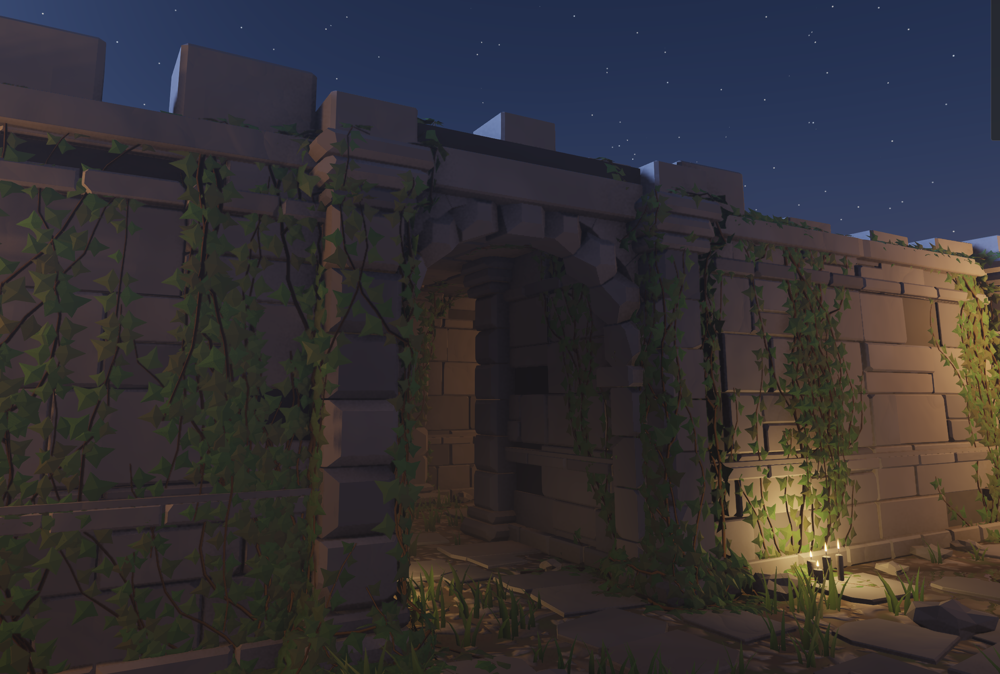

# Procedural OpenGL 4.6 Dungeon Renderer & SOR Modeller

A real-time GPU-driven OpenGL 4.6 Core 3D dungeon exploration engine paired with an interactive Surface-of-Revolution (`SOR_Modeller`) asset tool. Nearly all architecture, masonry variations, props, vegetation, PBR materials, and lighting are generated procedurally without external asset packs.



---

## Highlights

### Real-Time Rendering Pipeline (`MazeGame`)
- **Reversed-Z & GPU-Driven Geometry**: Uses `glClipControl(GL_LOWER_LEFT, GL_ZERO_TO_ONE)`, a unified `MegaVBO`/`MegaIBO` scene buffer (`glMultiDrawElementsIndirect`), and a **4-slot `GLsync`-fenced persistent-mapped `FrameUBO` ring buffer**.
- **Two-Pass HZB Occlusion Culling**: Previous-frame `GL_R32F` Hierarchical Z-Buffer culling paired with a current-frame disocclusion `DepthRescue` pass (`HzbPass`, `culling.comp`) plus GPU-culled instanced grass (`grass_cull.comp`).
- **Deferred PBR & Single-Pass Puddles**: Early-Z (`GL_EQUAL`) G-Buffer encoding octahedral normals, material IDs, and signed roughness/metallicity; `PuddlePass` overlays domain-warped fBm wetness and wind-rippled standing water onto base floor pixels without re-rendering geometry.
- **Shadows & Clustered Lighting**:
  - `2048×2048` texel-snapped directional moonlight shadow map with runtime `Moon Azimuth` / `Moon Elevation` controls.
  - `16×9×24` froxel clustered point-light culling (up to 64 lights/cluster) with bilinear 2D maze-grid wall occlusion (`evalPointLightWallVisibility`) to prevent torch light bleed through solid walls.
  - **Top-4 Static-Cached Omnidirectional Point Shadows** (`GL_TEXTURE_CUBE_MAP_ARRAY`, `256×256×6×4`) with hysteresis slot swapping, per-face frustum culling, and distance-faded rotated Poisson PCF.
- **GPU-Driven Sparse 3D L1 SH Probe GI**:
  - Screen-space visible probe marking (`gi_mark.comp`) -> stream compaction (`gi_compact.comp`) -> indirect-dispatched 3D Grid-DDA multi-bounce raytracing with persistent `8×8` octahedral radiance guiding (`gi_trace.comp`) -> temporal SH blending (`gi_blend.comp`) -> **half-resolution screen evaluation + depth-aware bilateral upsampling** (`gi_screen.frag`).
  - Built-in live inspection tools: **3D L1 SH Probe Spheres** (`ProbeDebugPass`), **Indirect GI Only** view, and **Whitebox Clay Mode**.
- **Atmosphere, Reflections & Post-Processing**:
  - Half-resolution oriented-hemisphere SSAO + `3×3` cross-bilateral depth blur.
  - Stochastic Screen-Space Planar Reflections (**SSPR**) using `imageAtomicMin` mirrored depth hashing and `3×3` hole-filling.
  - `128×72×48` 3D froxel temporal volumetric fog with Henyey-Greenstein phase scattering and GI ambient injection.
  - Animated HDR torch/candle flame billboards (`FlamePass`), 6-mip Karis/Jimenez HDR Bloom, ACES filmic tonemapping, and FXAA with dynamic `Render Scale` (`0.40x–1.00x`).
- **Async Startup & Profiling**: Background `std::async` CPU asset/scene generation overlapped with frame-sliced shader compilation and a live progress Loading Screen (also used when regenerating mazes via `R`), plus a `Tab` ImGui `Render & Demo Panel` featuring a zero-stall 4-frame `GL_TIMESTAMP` per-pass GPU timer.

### Procedural Generation & Tooling (`SOR_Modeller` + World Builders)
- **Interactive Lathe Modeller (`SOR_Modeller.exe`)**: Edit $C^1$-continuous piecewise cubic Bézier profiles with segment midpoint insertion and analytical surface normals around the Y-axis; exports `.dat` meshes mounted into semantic `MazeGame` slots (`treasure.dat` / `myModel.dat`, `torch.dat`, `candle.dat`, `vase.dat`, `cup.dat`) with automatic bounding-box fit scaling.
- **Maze Topology (`MazeGenerator`)**: Excavates open courtyards, grows branching corridors with straight-bias and max-unbranched limits, creates loop shortcuts while protecting dead-end treasure shrines, and prevents torches from clipping pillars or archways.
- **Masonry, Flora & Oases**: Chipped brick walls, ceilings, archways, pillars, pavers, planks, spatial-AABB-guided climbing/hanging ivy vines (`VineGenerator`), OBB- and puddle-aware courtyard bushes and grass (`FoliageGenerator`), and courtyard desert oases (`OasisGenerator`).
- **10-Layer `1024×1024` PBR Texture Array**: Combines GPU compute-baked floor/brick/wood materials (`TextureGenerator`) with CPU-generated gold, ivy, sand, water, bark, foliage, and a height-banded `kMatTorch` layer (wood grip, steel collars, forged iron brazier cup, charred rim) paired with seamless `atan2` `.dat` UV seam handling.

---

## Requirements & Build

- **Compiler**: C++20 compiler (tested on Windows / MSVC)
- **CMake**: `3.24` or newer
- **Graphics**: OpenGL `4.6` Core Profile capable GPU & driver
- **Dependencies** (fetched automatically via CMake `FetchContent`):
  - GLFW `3.4`
  - GLAD `2.0.8` (OpenGL 4.6 Core)
  - GLM `1.0.1`
  - Dear ImGui (`docking` branch)

### Build (Windows / MSVC)

```powershell
cmake -B build -S .
cmake --build build --config Release
```

Executables and synced shaders are output to `build/bin/Release/` (`MazeGame.exe`, `SOR_Modeller.exe`, and `shaders/`). Place exported `.dat` meshes (`treasure.dat`, `torch.dat`, `candle.dat`, `vase.dat`, `cup.dat`) alongside `MazeGame.exe`.

---

## Usage & Controls

### `MazeGame.exe`

| Input | Action |
| :--- | :--- |
| `W A S D` + Mouse | Move / Look |
| `Shift` | Sprint (or descend in Fly mode) |
| `Space` | Jump (or ascend in Fly mode) |
| `F` | Toggle Fly / Noclip camera |
| `M` | Toggle Fullscreen / Minimap view |
| `R` | Asynchronously generate a new dungeon |
| `Tab` | Toggle `Render & Demo Panel` (feature flags, moon angle, render scale, GI probe spheres, GPU pass timings) |
| `Esc` | Release / recapture cursor or close panel |

**CLI Flags**:
- `--smoke-test`: Headless verification run capturing 5 test viewpoints into `screenshots/`.
- `--probe-debug`: Enable 3D L1 SH Probe Sphere debug overlay at startup.
- `--gl-debug`: Enable OpenGL debug output context in Release builds.

### `SOR_Modeller.exe`
- Interactive 2D Bézier profile canvas + 3D Y-axis preview for creating and exporting `.dat` lathe models.
- Supports `--smoke-test` for headless build/export verification.

---

## Repository Layout

```text
├── CMakeLists.txt
├── notes/
│   ├── rendering_pipeline_overview.md       # 23-pass OpenGL 4.6 rendering architecture overview (Chinese)
│   ├── procedural_generation_overview.md    # SOR modeller, maze, masonry, flora & PBR baking overview (Chinese)
│   └── sparse_octahedral_probe_gi.md        # Deep dive into sparse 3D L1 SH probe GI & octahedral guiding (Chinese)
├── shaders/
│   ├── common/                              # Shared UBO, lighting, GI, HZB, fog & tonemapping GLSL headers
│   └── passes/                              # Compute, vertex & fragment shaders for all 23 render passes + baking
└── src/
    ├── common/                              # GL RAII wrappers & .dat mesh parser/writer
    ├── modeller/                            # SOR_Modeller application (cubic Bézier lathe & .dat exporter)
    └── game/                                # MazeGame gameplay, procedural generators & render passes
```
