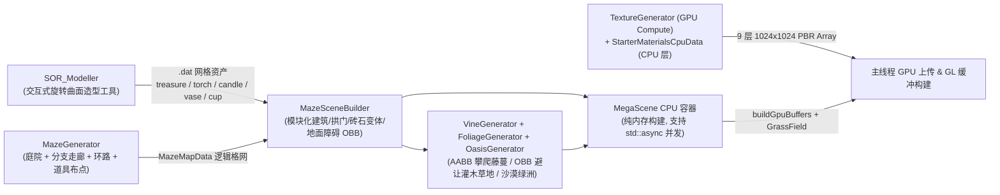

# 程序化生成与资产管线总览

本文整理项目中从 **离线旋转曲面建模工具** 到 **迷宫拓扑、建筑细节、自然植被、微生态绿洲以及 GPU 程序化 PBR 纹理** 的全链路程序化生成（Procedural Generation）设计思路与具体实现。

---

## 1. 整体内容生产链路

整个项目几乎不依赖外部现成美术模型与贴图，所有世界几何与表面材质由四大阶段流水线自动生成：

所有纯 CPU 构网流程（迷宫拓扑、石砌建筑变体、`.dat` 解析、藤蔓、灌木与草实例）均已与 OpenGL 上下文解耦为 [buildMazeSceneCpu](file:///f:/cpp/School/CG_Final/src/game/MazeSceneBuilder.cpp)，允许在后台线程独立运行并安全移交给主线程上传。

---

## 2. 核心子系统实现思路

### 2.1 自研旋转曲面建模器（`SOR_Modeller`，[src/modeller/](file:///f:/cpp/School/CG_Final/src/modeller/main.cpp)）
为了解决纯代码硬凑装饰小件几何形态单一的问题，单独编写了独立可执行工具 `SOR_Modeller.exe`：
- **分段 C1 连续三次贝塞尔轮廓（[profile_curve.hpp](file:///f:/cpp/School/CG_Final/src/modeller/profile_curve.hpp)）**：
  - 用户在 2D `(radius, height)` 视口点击控制点（支持移动点、删除点、**线段/曲线中点插入控制点**，以及内置 `Chalice / Vase / Pillar / Candle` 预设），`buildPiecewiseBezier` 自动构造分段三次贝塞尔曲线；
  - `sampleProfileCurve` 采样轮廓点位置的同时，通过 `CubicBezierSegment::evalDerivative` 直接求取精确的**解析曲线切线 `(dr/dt, dy/dt)`**。
- **绕 Y 轴封闭旋转体与解析法线（[sor_mesh.hpp](file:///f:/cpp/School/CG_Final/src/modeller/sor_mesh.hpp)）**：
  - 绕 Y 轴按指定经向分段数 `radialSegments` 旋转扫掠，自动处理顶/底闭合与接缝处 UV 连续性；
  - 法线通过表面两个正交切向量（周向旋转切线 × 轮廓线解析切线）叉乘得来，避免离散差分带来的环带接缝棱角，导出统一格式的 `.dat` 网格。
- **语义化资产槽位自动装配（[MazeSceneBuilder.cpp](file:///f:/cpp/School/CG_Final/src/game/MazeSceneBuilder.cpp#L347-L356)）**：
  - 游戏启动时自动从可执行文件目录加载 `treasure.dat`、`candle.dat`、`torch.dat`、`vase.dat`、`cup.dat`（缺失时平滑回退到程序化倒角盒）；
  - 利用 `.dat` 自带的包围盒信息（`fitScale(targetHeight, minRadius)`、`minY`）自动按目标高度归一化摆放，确保所有自制道具严丝合缝站在祭坛、墙面火把托架或地面角落。

---

### 2.2 迷宫拓扑与可玩性约束生成（[MazeGenerator.hpp](file:///f:/cpp/School/CG_Final/src/game/MazeGenerator.hpp) / [MazeGenerator.cpp](file:///f:/cpp/School/CG_Final/src/game/MazeGenerator.cpp)）
迷宫默认 `21×21` 格（每格 `3.0m`），目标不只是生成一张随机走通的图，而是构建**兼具探索感、开阔庭院对比、合理光影密度与零冲突布点**的地下遗迹布局：
1. **开敞庭院划区（`fillCourtyard`）**：在奇偶网格上随机划出多块矩形露天天井（`CellKind::Courtyard`），赋予高空天光、蓝月光阴影与植物生长空间，打破纯密闭走廊的视觉疲劳。
2. **多分支 Growing Tree 走廊（`fillCorridor`）**：
   - 采用可调节的 **Growing Tree 算法**（`corridorNewestBias = 0.72` 混合最新单元与随机回溯分支，产生丰富岔路而非单条长蛇通道）；
   - 加入方向惯性（`corridorStraightBias = 0.58`）和最长连续直道限制（`maxUnbranchedSteps = 3`），强制每隔几步出现转角或分支，天然适配 HZB 遮挡剔除与 GI 拐角反弹。
3. **拓扑连通、死胡同保护与长回路（`resolveDeadEndsExitAndTreasures` + `braidSpareDeadEnds` + `addLongLoopShortcuts`）**：
   - 通过 BFS 测算起点到全图的最短步数，选最远可步达格作终点出口 `exitCell`；
   - 优先挑选相互间保持最小曼哈顿/拓扑间隔（`minTreasureSeparation`）且远离起点的死胡同放置 5 个黄金圣物（保证死胡同探索价值）；
   - 先保护起点、终点、圣物格以及至少部分“诱饵死胡同”，再按 `braidRatio = 0.38` 打通多余死胡同，并在高步数绕远节点间按 BFS 距离差阈值开辟长回路捷径（`extraLoopCount = 2`），让动线四通八达但不破坏目标收集节奏。
4. **语义冲突规避布点（`populatePillarsAndBeams` / `populateOases` / `populateProps`）**：
   - 走廊石柱、拱门位置标记清楚；
   - 墙壁火把在布点时会主动避开拱门/门洞门柱位置及紧邻走廊柱体，防止火把模型与拱石穿模或挡路；
   - 地面蜡烛簇贴墙边与角落安全区分布，绿洲仅生成于尺寸足够（约 `2×2` 格以上）的开阔庭院且不侵占门口通道。

---

### 2.3 模块化遗迹建筑与石砌变体构网（[MazeSceneBuilder.cpp](file:///f:/cpp/School/CG_Final/src/game/MazeSceneBuilder.cpp)）
为摆脱早期“方块墙面+平面贴图”的单调感，场景构建器在 CPU 端现场生成了多套手工风格的程序化立体石构件：
- **倒角体与碎裂变体（Chipped Masonry）**：
  - 墙体、天花板、立柱均并非单个盒体，而是分别预设 **4 种墙面变体 (`wallVariantMeshes`)、2 种天花板变体 (`ceilingVariantMeshes`)、2 种立柱变体 (`pillarVariantMeshes`)** 与 4 种石板地砖 (`paverMeshes`)，内含高低错落的凸出石块、倒角、缺口以及腰线/底座/檐口条带；
  - 在 `vUV` 中巧妙打包局部语义参数：砖块编号盐值（与 `vObjectId` 结合形成独立砖块 ID）和砖缘距离系数 `brickEdge`，供着色器在逐像素阶段实现**无缝不闪烁的单砖色偏、粗糙度变化与缝隙深色 AO**。
- **门洞拱券与地面杂物碰撞登记（`FloorObstacleObb`）**：
  - 在庭院与走廊交界、指定通路节点自动立起由楔形拱石拼成的半圆拱门（`Archway`）和庭院矮墙垛口（Parapets）；
  - 每一块散落的地板石板（Paver）、风化木板（Plank）、花瓶、圣物底座都计算旋转后的 2D 有向包围盒 [FloorObstacleObb](file:///f:/cpp/School/CG_Final/src/game/FoliageGenerator.hpp#L16-L25) 并注册到障碍列表。

---

### 2.4 自然植被与微生态生成

#### 1) 空间网格引导的攀爬与垂挂藤蔓（[VineGenerator.cpp](file:///f:/cpp/School/CG_Final/src/game/VineGenerator.cpp)）
- **AABB 空间桶加速**：首先收集迷宫内所有墙面、门柱、庭院檐口等建筑包围盒，划分到与迷宫格一致的 `SpatialAabbIndex`（向外扩 1 格邻域桶），使每株藤蔓只需测试周围少数几个盒子。
- **爬墙与垂挂状态机**：藤蔓从立柱脚、墙脚或庭院檐顶出发，逐节点采样表面最近点贴墙向上扭动生长；一旦越过檐口边缘则转为自由重力下垂曲线（`hangWeight` 递增，赋予风吹摆动权重写入 `kObjectWindSwayFlag`），沿途按概率分叉出细侧枝并挂上折叠三尖常春藤叶片。
- **合批优化**：按空间区域（Chunk）将海量细碎枝叶合并成少量 Chunk Mesh 再加入 `MegaScene`，避免 Draw Call 和 Indirect 槽位爆炸。

#### 2) 植物簇与零穿模草场（[FoliageGenerator.cpp](file:///f:/cpp/School/CG_Final/src/game/FoliageGenerator.cpp)）
- **三种程序化灌木网格**：在庭院边缘与开敞位置放置由三次贝塞尔叶轴与 V 型折叠叶面组成的莲座簇、拱形蕨类与茎生阔叶植物。
- **零穿模与避水草场（`generateMazeGrass`）**：
  - 对每个可步达单元格（庭院 `10×10`、走廊 `8×8` 子网格加随机抖动）候选点做两项严格过滤：
    1. 与全部 `FloorObstacleObb` 做保留安全边距（`grassMinObstacleClearance = 0.105m`）的局部空间距离检测，绝不从石板/木板/花瓶内部长出草；
    2. 复现渲染期 `puddle.frag` 同一套 Domain-Warped 积水噪波函数评估地面干湿度，积水洼中心自动停止刷草、湿润泥边草密度与高度自然过渡，随后由 `GrassField` 全 GPU 剔除渲染。

#### 3) 庭院沙漠绿洲微生态（[OasisGenerator.hpp](file:///f:/cpp/School/CG_Final/src/game/OasisGenerator.hpp)）
- 对筛选出的 `OasisSpawn` 生成阶梯状沙岸与浅水洼网格、岸边多面体碎石（`rockMeshes`）、带弯曲树干与内外双层羽状椰叶（附椰果）的倾斜棕榈树、芦苇丛，以及一簇带暖色点光源和摇曳光照的篝火余烬。

---

### 2.5 GPU + CPU 混合程序化 PBR 材质阵列（[TextureGenerator.hpp](file:///f:/cpp/School/CG_Final/src/game/TextureGenerator.hpp) / [RenderResources.cpp](file:///f:/cpp/School/CG_Final/src/game/render/RenderResources.cpp#L963-L1196)）
全部材质打包进 `9 层 × 1024×1024` 的 `GL_TEXTURE_2D_ARRAY` 三连阵列（`Albedo` + `ORM(AO/Roughness/Metallic)` + `Normal/Height`，11 级 Mipmap）：
- **GPU Compute 实时烘焙层（Layer 0 地面、Layer 1 墙砖、Layer 8 木板）**：[TextureGenerator](file:///f:/cpp/School/CG_Final/src/game/TextureGenerator.cpp) 启动时调 Compute Shader 并行计算 100 万像素级别的高频程序化噪波、石缝微凹凸、泥土肌理与木纹年轮，速度极快且零磁盘图片体积。
- **后台线程纯 CPU 生成层（Layer 2~7：锻打古金、常春藤叶脉、沙岸、水波焦散、棕榈皮、植物叶脉）**：在 `generateStarterMaterialsCpu()` 先于 `256×256` 场计算对称高度图、中心差分法线及线性反照率并双线性放大到 `1024×1024`，待主线程空闲再通过 `glTextureSubImage3D` 上传并生成 Mipmap。
- **渲染期二次丰富**：结合 [gbuffer.frag](file:///f:/cpp/School/CG_Final/shaders/passes/gbuffer.frag) 中的墙脚潮湿渐变裙边、单砖石板随机明暗偏移与边缘磨损高光，使同一张程序化纹理贴在不同位置也几乎看不出重复平铺感。
