# 实时渲染管线总览（OpenGL 4.6 Core）

本文梳理 `MazeGame` 当前实现的完整实时渲染架构、23 个 Render Pass 的执行链路与数据流向，以及核心机制（GPU-Driven 剔除、延迟着色、阴影缓存、半分辨率 GI/SSAO、体雾、SSPR 与性能剖析）的设计考量与工程取舍。关于 3D 稀疏八面体探针 GI 的底层推导与踩坑细节，可参阅姐妹篇 [sparse_octahedral_probe_gi.md](file:///f:/cpp/School/CG_Final/notes/sparse_octahedral_probe_gi.md)。

---

## 1. 整体架构与底层约定

项目基于 **OpenGL 4.6 Core Profile**，大量采用 **DSA（Direct State Access）**、`std140/std430` 统一缓冲区、`GL_TEXTURE_2D_ARRAY` 纹理阵列以及 `glMultiDrawElementsIndirect` 构建近似现代 Vulkan/D3D12 风格的 **GPU-Driven 延迟+前向混合管线**。

### 核心基础设施（[RenderResources.hpp](file:///f:/cpp/School/CG_Final/src/game/render/RenderResources.hpp) / [Renderer.cpp](file:///f:/cpp/School/CG_Final/src/game/render/Renderer.cpp)）
- **Reversed-Z 深度精密映射**：初始化时调用 `glClipControl(GL_LOWER_LEFT, GL_ZERO_TO_ONE)`，投影矩阵反传 `(far, near)`，清屏深度为 `0.0`，深度测试采用 `GL_GREATER`。极大缓解远距离墙壁、石板接缝及阴影偏移时的 Z-Fighting。
- **4 槽位 Persistent-Mapped UBO 环形缓冲 + `GLsync` 栅栏**：[RenderResources](file:///f:/cpp/School/CG_Final/src/game/render/RenderResources.cpp) 为 `FrameUniforms` 维护 4 帧循环的持久化映射缓冲，在写入前通过 `glClientWaitSync` 等待旧栅栏，提交后插入 `glFenceSync(GL_SYNC_GPU_COMMANDS_COMPLETE, 0)`，彻底避免 CPU 覆写 GPU 仍在读取的矩阵/参数导致的画面闪烁。
- **单一 MegaBuffer 场景表示（[MegaScene.hpp](file:///f:/cpp/School/CG_Final/src/game/render/MegaScene.hpp)）**：所有静态/动态网格顶点与索引合并进入全局 `MegaVBO`/`MegaIBO`；每个物体以 `DrawObjectData`（含模型矩阵、法线矩阵、世界包围球、材质层与状态位）存入 SSBO，按 `meshId` 分桶进行 GPU 前缀和与间接绘制。
- **零阻塞 Per-Pass GPU Profiler（[Renderer.hpp](file:///f:/cpp/School/CG_Final/src/game/render/Renderer.hpp)）**：维护 `kQueryRing = 4` 的 `GL_TIMESTAMP` 查询环，仅在打开 `Tab` 调试面板时写入时间戳并回读 3 帧前的无阻塞结果，防止流水线同步停顿。

---

## 2. 完整 23-Pass 渲染流程图

```mermaid
flowchart TD
    ShadowCull["1. ShadowCull\n(方向光视锥 GPU 剔除)"] --> ShadowMap["2. ShadowMap\n(2048x2048 方向光深度图)"]
    ShadowMap --> PointShadow["3. PointShadow\n(Top-4 缓存全向点光阴影立方体阵列)"]
    PointShadow --> MainCull1["4. MainCull1\n(视锥 + 上帧 HZB 遮挡剔除)"]
    MainCull1 --> DepthPass1["5. DepthPass1\n(Reversed-Z 主体深度预通道)"]
    DepthPass1 --> HzbBuild1["6. HzbBuild1\n(构建当前帧 PoT HZB 金字塔)"]
    HzbBuild1 --> MainCull2["7. MainCull2\n(当前 HZB Rescue 重投影剔除 + 草丛剔除)"]
    MainCull2 --> DepthRescue["8. DepthRescue\n(补绘上一帧被误挡的新露面物体)"]
    DepthRescue --> HzbBuild2["9. HzbBuild2\n(更新最终 HZB 供下一帧使用)"]
    HzbBuild2 --> DepthGrass["10. DepthGrass\n(双面草叶实例化深度预通道)"]
    DepthGrass --> GBuffer["11. GBuffer\n(GL_EQUAL Strictly Early-Z 写出表面属性)"]
    GBuffer --> Puddles["12. Puddles\n(程序化噪波在地面覆写潮湿与积水表面参数)"]
    Puddles --> LightCull["13. LightCull\n(16x9x24 Froxel 聚簇点光源剔除)"]
    LightCull --> SSAO["14. SSAO\n(半分辨率定向半球 AO + 3x3 双边滤波)"]
    SSAO --> ProbeGI["15. ProbeGI\n(标记 -> 压缩 -> Grid-DDA 追迹 -> 混合 -> 半分辨率屏幕求值)"]
    ProbeGI --> Composite["16. Composite\n(延迟 PBR 光照合成 + 阴影 + 聚簇点光 + 上采样 GI)"]
    Composite --> Flames["17. Flames\n(深度测试前向程序化 HDR 火焰 Billboard)"]
    Flames --> SSPR["18. SSPR\n(屏幕空间原子哈希平面反射 + 补洞 + 积水混合)"]
    SSPR --> ProbeDebug["19. ProbeDebug\n(可选 3D L1 SH 探针球调试可视化)"]
    ProbeDebug --> VolFog["20. VolFog\n(128x72x48 3D Froxel 时域体雾注入与前向积分)"]
    VolFog --> Bloom["21. Bloom\n(6-Mip HDR Karis 预过滤 + 13-tap 降采样 + Tent 上采样)"]
    Bloom --> PostProcess["22. PostProcess\n(体雾叠加 + Bloom + ACES Tonemap + sRGB/Luma)"]
    PostProcess --> FXAA["23. FXAA\n(抗锯齿并按 Render Scale 双线性放大到窗口分辨率)"]
```

---

## 3. 核心模块设计思路与实现细节

### 3.1 GPU-Driven Two-Pass HZB 遮挡剔除（[culling.comp](file:///f:/cpp/School/CG_Final/shaders/passes/culling.comp) / [HzbPass.cpp](file:///f:/cpp/School/CG_Final/src/game/render/passes/HzbPass.cpp)）
- **痛点**：迷宫走廊遮挡极深，纯视锥剔除仍会把大量隔墙后的房间模型送入光栅化；但仅用上一帧 HZB 直接剔除，在玩家快速转身或推门拐角时会出现新露面物体“慢一帧闪现”的 Popping 伪影。
- **方案**：
  1. **Pass 1 (`MainCull1` + `DepthPass1`)**：用上一帧的 HZB（`uPrevViewProj` 投影每个物体 AABB）配合小物体屏幕占比剔除（`screenHeightPct < 0.018`），将认为可见的物体写出主命令缓冲 `Cmds[]` 并绘制深度。被上一帧 HZB 判定遮挡但仍在视锥内的物体不直接丢弃，而是标记 `CullStates[objId] = 2u` 作为 **Rescue 候选**。
  2. **构建 HZB (`HzbBuild1`)**：从 `DepthPass1` 生成最大像素预算不超过 `262144`（如 `512×512`）的 Power-of-Two `GL_R32F` Min-Depth 金字塔（Reversed-Z 下存最远深度即 `min`）。
  3. **Pass 2 (`MainCull2` + `DepthRescue`)**：只针对 `CullStates[objId] == 2u` 的候选，用**当前帧相机矩阵 `uViewProj`** 在新 HZB 上复检；若本帧确实可见，则**既追加进主 `Cmds[]` 供后续 GBuffer 绘制，又单独写入 `RescueCmds[]` 补画深度**。
  4. **最终更新 (`HzbBuild2`)**：结合 `DepthRescue` 的补画结果刷新当前帧 HZB，留给下一帧做 Pass 1 参考；同时由 `grass_cull.comp` 对草丛做视锥、距离与 HZB 剔除。

### 3.2 Early-Z G-Buffer 与单通道地面微环境修饰（[GBufferPass.cpp](file:///f:/cpp/School/CG_Final/src/game/render/passes/GBufferPass.cpp) / [puddle.frag](file:///f:/cpp/School/CG_Final/shaders/passes/puddle.frag)）
- **G-Buffer 布局**：
  - `m_gbuffer0` (`GL_RGBA8`)：`Albedo.rgb + Material AO`
  - `m_gbuffer1` (`GL_RGBA16F`)：`OctNormal.xy + MaterialId + SignedRoughness`（用符号位区分金属度，负值代表金器/圣物等金属表面，正值代表石材/植物等非金属）
- **Strictly Early-Z 零过度绘制**：由于 `DepthPrePass` 已完整填充 `m_depthTex`，`GBufferPass` 关闭深度写（`glDepthMask(GL_FALSE)`）并将深度测试设为 `GL_EQUAL`，确保复杂片元着色器（砖石微调、切线微分与纹理采样）每像素严格只运行 1 次。
- **砖缝 TBN 微分防爆点**：[gbuffer.frag](file:///f:/cpp/School/CG_Final/shaders/passes/gbuffer.frag) 先在连续 World Box UV 上计算 `dFdx`/`dFdy`，再施加每块砖随机偏移 `brickId`，并用 `1024.0` 缩放偏导以免 `2×2` Quad 边缘在近距离出现精度崩坏产生法线闪烁黑点。
- **零重画程序化积水 (`PuddlePass`)**：绑定刻意不带 Depth Attachment 的 `m_puddleFbo`（合法同时采样 `uDepthTex` 与旧 G-Buffer），仅针对地面材质（`matId == 0u`）利用 Domain-Warped fBm 划出潮湿深色泥土带与平滑低粗糙度水面（叠加微风波纹扰动法线），其余墙体、石板、植物直接 `discard`。

### 3.3 聚簇点光源、双线性防穿墙与 Top-4 全向点光阴影（[composite.frag](file:///f:/cpp/School/CG_Final/shaders/passes/composite.frag) / [PointShadowPass.cpp](file:///f:/cpp/School/CG_Final/src/game/render/passes/PointShadowPass.cpp)）
- **Clustered Lighting**：`LightCullingPass` 将相机视椎体划分为 `16×9×24 = 3456` 个对数深度 Froxel 簇，每簇最多记录 64 盏重叠点光源，从容承载数十上百盏走廊火把、蜡烛堆、圣物与绿洲余烬的实时渲染。
- **Top-4 静态缓存点光源立方体阴影**：
  - `RenderResources::updatePointShadowSlots` 选出离玩家最近的 4 盏主火把，用迟滞距离替换策略分配到 `256×256×6×4` 的 `GL_TEXTURE_CUBE_MAP_ARRAY`（配合距离平滑 `fade` 避免边界突兀）；
  - 因为火把固定在墙上，只有某槽位初次分配、玩家大步瞬移或重新生成迷宫时才将 `slot.dirty` 置位，逐个立方体面做视锥剔除（`uCullMode == 3`）重绘，平时移动复用缓存 **几乎零 GPU 耗时**；
  - `composite.frag` 对命中槽位的光源做 4-tap 屏幕空间随机旋转 Poisson PCF 采样。
- **点光源双线性网格防穿墙遮挡**：由于只有 Top-4 光源拥有几何 ShadowMap，其余几十盏普通火把/蜡烛通过 [gi_common.glsl](file:///f:/cpp/School/CG_Final/shaders/common/gi_common.glsl) 的 `evalPointLightWallVisibility`（8 步沿光路采样 `sampleWallCoreDensity` 双线性插值墙体核密度）实现柔和且无硬分割线的墙体隔离。

### 3.4 稀疏 L1 SH GI、半分辨率屏幕评估与探针球可视化
- 探针标记、压缩、Grid-DDA 多反弹追踪和 `8×8` 八面体缓存细节见 [sparse_octahedral_probe_gi.md](file:///f:/cpp/School/CG_Final/notes/sparse_octahedral_probe_gi.md)。
- **本次针对桌面与核显带宽做的关键演进**：
  1. **Half-Res Screen-Space GI（[gi_screen.frag](file:///f:/cpp/School/CG_Final/shaders/passes/gi_screen.frag)）**：原本 `CompositePass` 在全分辨率下对每个像素手动跑 `2×2×2`（最多 32 次 `texelFetch`）SH 采样；现将该采样下放到与 SSAO 同尺寸的半分辨率 `GL_RGBA16F` 缓冲 `m_giScreenTex`（同时存下线性 `viewZ`），`CompositePass` 只需做 4-tap **深度感知双边上采样**（自动过滤天空邻居 `alpha <= 0` 与墙缘深度跳变），采样数降至 1/4 且无穿墙/轮廓黑边。
  2. **Shader 真特性掩码短路（`uFogDims.w` + `uShadowParams.zw`）**：关闭 Shadow / PointShadow / GI / SSAO / Fog / Bloom 时在 UBO 中明确写入位标志，让 `composite.frag`、`gi_trace.comp`、`fog_inject.comp` 和 `postprocess.frag` 在 GPU 内部直接跳过无效循环而非对 1×1 空纹理白跑 ALU。
  3. **动态演示与三维调试工具链**：
     - 将月光方向抽离为 UBO 变量 `uMoonDir`，支持水平方位角/垂直仰角实时拖动，联动天空月亮圆盘、阴影矩阵、体雾光束与 GI 反弹；
     - 新增 [ProbeDebugPass.cpp](file:///f:/cpp/School/CG_Final/src/game/render/passes/ProbeDebugPass.cpp)（实例化 `32×16` 光滑球体，启用 Reversed-Z `glDepthMask(GL_TRUE)` 与物理雾效遮挡），直观展示每个探针球的 `evalL1Rgb` 方向性受光瓣与休眠/唤醒状态，并配合 `Indirect GI Only`、`Whitebox Clay Mode` 做实时 GI 演示。

### 3.5 SSPR 平面反射、时域体积雾与后期管线
- **SSPR（[sspr_project.comp](file:///f:/cpp/School/CG_Final/shaders/passes/sspr_project.comp) / `sspr_resolve.comp` / `sspr_apply.comp`)**：对高度 `y > 0.004` 的几何像素沿 `y = 0` 地平面镜像重投影，用深度桶+像素坐标打包后 `imageAtomicMin` 解决最近反射遮挡；在 Resolve 阶段做 `3×3` 补洞后，结合积水噪波波纹和天光/GI 回退叠加至 `m_hdrTex`。
- **3D Froxel 时域体雾（[VolumetricFogPass.cpp](file:///f:/cpp/School/CG_Final/src/game/render/passes/VolumetricFogPass.cpp)）**：在 `128×72×48` 视锥体素网格中注入月光阴影、Henyey-Greenstein 相位函数、聚簇点光源及 3D SH GI 散射光并做历史帧时域重投影平滑，随后逐深度片做前向散射/透射率积分。
- **HDR 后处理与动态分辨率缩放**：6 级 `GL_R11F_G11F_B10F` Bloom（Karis 防萤火虫闪烁预过滤 -> 13-tap 降采样 -> 9-tap 帐篷上采样）-> ACES Filmic 色调映射 -> 终末由 [FxaaPass.cpp](file:///f:/cpp/School/CG_Final/src/game/render/passes/FxaaPass.cpp) 在原生窗口尺寸执行抗锯齿或双线性 `Render Scale`（`0.40x–1.00x`）放大输出，保证 HUD 与 ImGui 文字始终保持原生清晰度。

---

## 4. 异步初始化与性能剖析总结

- **异步加载与防卡顿（[main.cpp](file:///f:/cpp/School/CG_Final/src/game/main.cpp)）**：利用双后台线程并行执行纯 CPU 的材质像素预计算（2..7 层）和全套迷宫/建筑/植被场景构建，主线程在保证窗口 `glfwPollEvents()` 响应和 animated Loading Screen 刷新的前提下逐 Pass 编译 23 套 GLSL 着色器并分步上传 GPU 资源；游戏内按 `R` 重生成迷宫同样采用异步重建浮层。
- **硬件实测定位（Surface Pro 9 Iris Xe 对比独立显卡）**：通过 `GL_TIMESTAMP` 剖析确认在全场景 ~316.8 万全帧三角面与高分辨率带宽压力下，超极本核显主要受限于几何光栅化与像素带宽；经过 Half-Res GI 与真开关短路并在桌面独显（GTX 1660 及以上）或 `Render Scale` 缩放下可稳定高帧率流畅运行。
