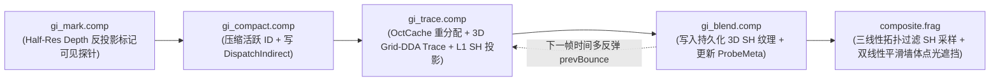

# GPU-Driven Sparse 3D Probe GI & `8×8` Octahedral Path Guiding Implementation Notes

本文记录项目中实时全局光照（GI）系统的完整架构设计、算法细节，以及从零搭建到消除闪烁、低射线能量丢失、地面硬接缝过程中的真实踩坑与解决方案。

---

## 1. 系统概览与设计目标

- **目标**：无离线烘焙（Zero-Bake）、支持任意实时动态光源（月光阴影变化、玩家携带光源、摇曳火把与遗物发光）、多反弹漫反射（Temporal Multi-Bounce）、防穿墙/跨屋顶漏光，并在高稀疏率下以极低开销（`16–64 rays/probe`）稳定跑满 `60 FPS`。
- **空间策略**：利用迷宫程序化网格结构 `m_mazeGridTex`（`GL_R8UI`，`0=Wall, 1=Roofed, 2=Courtyard`）构建稀疏 3D L1 球谐（L1 SH）探针场，并在每个探针上附加一层**世界方向固定的 `8×8` 八面体辐射度缓存**驱动 **Lighting PDF Ray Reallocation**（参考 UE5 Lumen 思想，并针对 World Probe 裁剪掉不必要的 BRDF PDF）。

---

## 2. 核心架构与 GPU 数据流



### 2.1 关键资源布局（[RenderResources](file:///f:/cpp/School/CG_Final/src/game/render/RenderResources.hpp) / [RenderResources.cpp](file:///f:/cpp/School/CG_Final/src/game/render/RenderResources.cpp#L268-L356)）

| 资源名 / Binding | 类型 / 规格 | 用途 |
| :--- | :--- | :--- |
| `m_mazeGridTex` | `GL_TEXTURE_2D` (`GL_R8UI`) | 迷宫 2D 单元格语义图（`kGiCellWall=0`, `kGiCellRoofed=1`, `kGiCellCourtyard=2`） |
| `m_giShTex[0..2]` | 3 × `GL_TEXTURE_3D` (`GL_RGBA16F`, `(W*2)×5×(H*2)`, 示例 `42×5×42=8820`) | 持久化 3D L1 SH 场（分别存 R/G/B 的 `(SH0, SH1.xyz)`） |
| `m_giProbeMetaSSBO` (`binding=7`) | `uint[totalProbes]` | `0u`: 墙体内部或非庭院屋顶上方无效探针；`1u`: 有效但从未激活过（首帧直通 `alpha=1`）；`2u`: 已初始化稳态探针 |
| `m_giActiveFlagSSBO` (`binding=8`) | `uint[totalProbes]` | 每帧清零，由半分辨率可见像素原子置 `1u` |
| `m_giActiveListSSBO` (`binding=9`) | `uint[totalProbes]` | 紧凑后的本帧可见活跃探针 ID 列表 |
| `m_giDispatchCmdSSBO` (`binding=10`) | `uint[3]` | `{NumGroupsX, 1, 1}`，`GL_DISPATCH_INDIRECT_BUFFER` |
| `m_giStagingShSSBO` (`binding=11`) | `vec4[totalProbes * 3]` | 本帧工作组归约出的活跃探针 L1 SH 暂存区 |
| `m_giOctCacheSSBO` (`binding=12`) | `uvec2[totalProbes * 64]` | 每探针 `8×8` 八面体持久化缓存：`packHalf2x16(r, g)` + `packHalf2x16(b, age)`（约 `4.3 MB`） |

空间步长与网格原点（[RenderResources.cpp](file:///f:/cpp/School/CG_Final/src/game/render/RenderResources.cpp#L257-L262)）：
- 水平方向每单元格放 `2×2` 个探针：`stepXZ = cellSize * 0.5`（默认 `1.5m`），`originXZ = stepXZ * 0.5`；
- 垂直方向 `5` 层：`stepY = wallHeight * 0.25`，`originY = stepY * 0.5`。

### 2.2 四阶段 Compute Pass（[GIPass.cpp](file:///f:/cpp/School/CG_Final/src/game/render/passes/GIPass.cpp)）

1. **Visibility Mark（[gi_mark.comp](file:///f:/cpp/School/CG_Final/shaders/passes/gi_mark.comp)）**：按半分辨率（`2×2` 步长）读取 Reversed-Z 深度与 G-Buffer 法线，按 `samplePos = worldPos + N * 0.16` 找到包围它的 `2×2×2` 探针格点，通过 `isGiProbeValid` 过滤后标记 `ActiveFlags[id] = 1u`。
2. **Stream Compaction（[gi_compact.comp](file:///f:/cpp/School/CG_Final/shaders/passes/gi_compact.comp)）**：扫描所有探针，将活跃探针连续压入 `ActiveProbeIds` 并递增 `NumGroupsX`，避免给屏幕外迷宫探针跑任何射线追踪。
3. **Raytrace & Octahedral Guiding（[gi_trace.comp](file:///f:/cpp/School/CG_Final/shaders/passes/gi_trace.comp)）**：
   - 使用 `glDispatchComputeIndirect(0)`，每个 WorkGroup 负责 1 个活跃探针；
   - 合作式剔除对本探针无影响的远距点光源（`sLightIndices[32]`）；
   - 通过结构化 **3D Grid-DDA（`traceMazeGridRay`）** 对墙体、地板、屋顶上下表面直接解析求交（相比通用三角形 BVH 几乎零构建成本且无几何锯齿穿漏）；
   - 命中天空盒则解析求值 `evalNightSky(rayDir)`（无需额外 SH9 烘焙）；命中表面则计算 Directional Moonlight Shadow + 局部点光源 + 上一帧 3D SH 的多反弹（`prevBounce * 0.72 * hitAlbedo`）。
4. **Temporal Blend（[gi_blend.comp](file:///f:/cpp/School/CG_Final/shaders/passes/gi_blend.comp)）**：从 `StagingSh` 写入 `uOutSh0..2`，首帧 `alpha = 1.0`，稳态因 `OctCache` 已做逐格滤波故只需轻混 `alpha = 0.35`，并置 `ProbeMeta[probeId] = 2u`。

---

## 3. 核心算法拆解：世界固定 `8×8` 八面体 & Ray Reallocation

### 3.1 为什么 World Probe 不需要 Lumen Slide 里的 `BRDF PDF`？
UE5 Lumen 演示中的 `BRDF PDF * Lighting PDF` 针对的是 **Screen Probe**（直接附着在 G-Buffer 像素表面，有明确表面法线 $N$ 与材质粗糙度，因此 $N \cdot \omega \le 0$ 的背面半球可以直接裁掉）。  
而我们的探针是**悬浮在走廊/庭院空间中的 World Probe**：单个探针必须同时服务周围地面（$+Y$）、拱顶（$-Y$）和四面墙壁（$\pm X, \pm Z$），本身没有单一表面法线和 BSDF，先验响应全向均匀（$1.0$）。法线余弦过滤只在最后着色的 `sampleProbeGiFiltered` 中完成，因此引导阶段**只需使用 Lighting PDF**。

### 3.2 精确八面体立体角 Jacobian 校正
标准八面体映射将 $[-1, 1]^2$ 折叠到 $|x|+|y|+|z|=1$ 的八面体表面点 $p$ 上再归一化。由于八面体中心与棱角离原点的距离 $r = \|p\|$ 不同，等面积格子对应的真实球面立体角与 $1/r^3$ 成正比：
```glsl
vec3 p = octDecodeRaw(centerUV);
float r = length(p);
float solidWeight = 1.0 / (r * r * r); // 归一化使 64 格均值严格为 1.0
```
将每个世界固定格子的 `sCellWeight[c]` 归一化到均值 `1.0` 后再向 L1 SH 积分，可以严格保证能量的无偏守恒（不因八面体投影畸变高估/低估特定轴向亮度）。

---

## 4. 踩坑记录与解决方案（实战复盘）

### 坑 1：把 `RAY_COUNT` 改成 `32` 直接崩溃 / 异常
- **现象**：早先 L1 SH Path Guiding 版本中默认 `RAY_COUNT = 64`，手动将宏改为 `32` 后工作组归约越界。
- **根因**：`sampleGuidedRay` 里的均分/引导半区分割写死了 `32u`，且共享内存归约首步步长写死了 `stride = 32u`。
- **方案**：全部逻辑替换为基于 `uint(RAY_COUNT)` 的参数化计算（`halfCount = uint(RAY_COUNT) >> 1u`，`stride = uint(RAY_COUNT) >> 1u`，支持 `16 / 32 / 64` 任意 2 的幂次）。

### 坑 2：L1 SH Path Guiding 在 `64` ray 下仍有约 `2%` 角落闪烁
- **现象**：98% 区域静止稳定，但部分角落和双光源夹角处的探针仍出现细微抖动。
- **根因**：旧版从上一帧 SH 提取单一连续主方向 `sMainDir` 并旋转一半射线去贴近它。亮源稍有微弱变化，`sMainDir` 就会发生 `1°–3°` 摆动，带动离散射线反复扫过墙角/门洞边缘，形成方向旋转极限环震荡；同时 L1 SH 单峰无法同时顾及走廊两头的多个亮源。
- **方案（参考 Lumen 重分配思路彻底重构）**：
  1. 用持久化的**世界固定 `8×8` 八面体缓存（`OctCache`）**取代连续旋转的 `sMainDir` 引导——64 个基准方向永远钉死在世界空间格子里，只调权重不转方向，斩断旋转震荡环；
  2. 稳态帧保留最多 `RAY_COUNT / 4`（低射线时 `3/8`）的射线做冷格轮转刷新（`age >= 4`），其余射线按 Lighting PDF 用最大余数法动态重分配，让多处高亮方向自动同时分到 `2–4` 条带 R2 分层子偏移的 supersampling 射线；
  3. 本帧未被分配射线的暗格直接保留缓存平滑值并递增 `age`，消除“0/1 阈值来回跳变”带来的闪烁；最终 64 个格子全向无偏积分投影到 L1 SH。

### 坑 3：GLSL 保留字导致 Compute Shader 编译失败
- **现象**：`gi_trace.comp` 报错 `syntax error, unexpected '=', expecting ';' or '(' at token "="`。
- **根因**：使用 `uvec2 packed = OctCache[...];` 定义局部变量，而 `packed` 在 GLSL 4.6 中是保留的存储布局限定符关键字。
- **方案**：变量重命名为 `packedVal`。

### 坑 4：降到 `RAY_COUNT = 16` 画面极其稳定，但明显比 `64` 暗
- **现象**：八面体上线后即使开 `RAY_COUNT = 16` 也完全不闪，但整体 GI 亮度明显低于 `64` ray 版本。
- **根因**：
  1. 当时 `firstTime` 针对 `RAY_COUNT < 64` 使用的是线性跨步 `c = k * (64 / 16)`，16 条射线全部落在了八面体第 `0` 列与第 `4` 列；后面的 4 邻域补空逻辑够不到距离为 `2` 的第 `2, 6` 列，导致 **`25%`（`16/64`）的球面格子首帧直接初始化成纯黑 `vec3(0.0)`**；
  2. 后续每帧冷格刷新预算仅 `4` 条且混合系数固定 `0.10`，黑洞格要等十几帧才轮到一次且每次只抬升 10%，在 `prevBounce * 0.72` 多反弹时间反馈下形成了持久亮度亏空。
- **方案（[gi_trace.comp](file:///f:/cpp/School/CG_Final/shaders/passes/gi_trace.comp#L334-L343), [#L557-L600](file:///f:/cpp/School/CG_Final/shaders/passes/gi_trace.comp#L557-L600)）**：
  1. `RAY_COUNT <= 16` 首帧按 `4×4` 超块（对应 `16` 个 `2×2` 八面体块）均匀发射射线，并整块拷贝初始化给块内 4 个子格，保证首帧 `64/64` 全向零黑洞；
  2. 将冷格轮转预算提高到 `max(4u, (RAY_COUNT * 3u) >> 3u)`，低射线数下限制单格最大上限为 `2u` 避免少数亮格吃光预算；
  3. 混合系数引入未更新帧龄补偿 `ageBoost = min(sCellAge[c], 8.0) * 0.025`（上限 `0.35`），既保持高频平滑，又让轮转到的冷格迅速收敛到 `64` ray 同等亮度。

### 坑 5：地面出现横平竖直 L 型接缝，调整后变成斜向软接缝
- 问题背景与视觉现象
场景中分布着大量墙面火把与地面蜡烛，但未为每盏点光源单独渲染 Shadow Map。为了防止走廊一侧的火把直接穿透 `3m` 厚的隔墙照亮相邻走廊，片段着色器（`composite.frag`）需要基于 2D 迷宫网格 `mazeGrid` 计算一个解析/步进的**点光源可见性遮挡系数**。
  1. **现象：** 部分走廊转角与庭院地面上出现了横平竖直切断暖光的 **“L 型暗块”** 与竖直接缝。
  2. **关键特征：** 无论将 GI 探针的射线数 `RAY_COUNT` 设为 `16` 还是 `64`，该接缝都纹丝不动，说明问题与探针采样噪声无关。

- 排查误区：为什么不是 GI 探针插值导致的？
起初怀疑是稀疏 GI 探针的三线性插值跨越网格边界时产生了跳变，但经过权重连续性分析排除了这一假设：
  1. `sampleProbeGiFiltered` 在地面上的插值权重系数是 **$C^0$ 连续**的——当着色点越过网格边界时，离开那一侧探针面的权重会平滑衰减归 `0`。
  2. 一个 $C^0$ 连续的插值场在数学上不可能切出非对齐的 $90^\circ$ 直角硬边，因此根因必然出在**点光源直接光照的防穿墙可见性函数**上。

#### 根因拆解与三代算法演进

- 第一代：离散步长采样 + 二值截断（导致 L 型硬块）
    - **实现方式：** 在 `composite.frag` (`shaders/passes/composite.frag#L114`) 中逐像素调用旧版 `isPointLightVisibleInGrid`，沿着色点 `surfPos` 到光源 `lightPos` 的连线按离散步长取点采样 `mazeGrid`。只要任意采样点落入墙壁格子 `kGiCellWall`，直接返回 `bool` 假值（完全遮挡）。
    - **失效原因：** `mazeGrid` 是 `3m × 3m` 的轴对齐正方形网格。离散点采样配合二值硬截断，相当于直接把 `3m × 3m` 的方格子当成硬阴影投射体“印”在了地板上，画出了横平竖直的硬边和 $90^\circ$ L 型暗块。

- 第二代：精确 2D Grid-DDA 穿墙弦长（导致斜向软接缝）
    - **实现方式：** 将离散采样改为精确的 **2D Grid-DDA** 光线步进，计算光线穿过 `kGiCellWall` 格子的精确几何弦长 `blockedDist`，再通过 `smoothstep(0.95, 0.08, blockedDist)` 过渡阴影边缘。
    - **失效原因：** L 型硬块虽然消失，但暴露出新的几何瑕疵——底层 `kGiCellWall` 网格在数学上拥有**绝对尖锐的 $90^\circ$ 顶点**，且壁挂火把距离墙面仅有 **`0.14m`**。当视线掠过尖锐墙角顶点时，光线穿墙弦长随角度微偏产生笔直的线性变化，在地板上投射出一道约 **`35cm` 宽、严格对齐“火把 $\rightarrow$ 墙角顶点”连线的斜向渐变带**（即半影接缝）。

- 第三代（终极方案）：双线性墙体核心密度场 + 固定 14 步光学深度积分
核心思路从 **“硬表面几何求交（Ray-Box Intersection）”** 彻底转向 **“低通滤波后的连续密度场体积积分（Volumetric Raymarching）”**，实现于 `shaders/common/gi_common.glsl#L131-L167`：

```glsl
// 1. 4-tap 双线性采样原始 0/1 网格并映射为墙体核心密度
float raw  = bilinear(mazeGrid == Wall);
float core = smoothstep(0.50, 0.78, raw);

// 2. 沿 surfPos -> lightPos 固定 14 步中点积分累计等效穿墙光学深度
float opticalDepth = 0.0;
for (int i = 0; i < 14; ++i) {
    vec2 midPos = mix(surfPos.xz, lightPos.xz, (float(i) + 0.5) / 14.0);
    opticalDepth += sampleWallCoreDensity(midPos) * stepLen;
}

// 3. 反向 smoothstep 输出 C^1 连续可见度
float visibility = smoothstep(1.35, 0.35, opticalDepth);

```

- 为什么 `smoothstep(0.50, 0.78, raw)` 能把 $90^\circ$ 墙角“倒圆”成半径 ~1m 的圆角？
4-tap 双线性采样的四个基准点位于相邻 4 个 `3m × 3m` 格子的**中心**，构成一个局部归一化坐标 $(u, v) \in [0, 1]^2$ 的对偶正方形。
    - **平直墙面边界精准对齐（不误伤近墙光照）：**
当右侧两格为墙（$1$）、左侧两格为空地（$0$）时，插值退化为 $\text{raw}(u, v) = u$。阈值起点 **`0.50`** 恰好落在 $u = 0.5$（即距格子中心 $1.5\text{m}$ 的物理墙面上）。因此，所有走廊开放区域甚至紧贴墙皮的位置（`raw <= 0.50`）算出的密度 `core` **严格为 `0.0**`，确保离墙仅 `0.14m` 的火把绝不会自己遮黑自己或误暗本走廊墙壁。
    - **外凸墙角的双曲线倒圆：**
当只有右上角一格为墙（$f(1,1)=1$）、其余三格为空地（$0$）时，二维双线性插值公式化简为：

$$\text{raw}(u, v) = u \cdot v$$

此时墙体核边界 $\text{raw}(u, v) = 0.50$ 的等值线方程为双曲线 $v = 0.5 / u$。它不再延伸到尖角 $(0.5, 0.5)$，而是在 $u = v = \sqrt{0.5} \approx 0.707$ 处向墙体内部平滑收缩：

$$\Delta d = \sqrt{2} \times (0.707 - 0.5) \times 3\text{m} \approx 0.88\text{m}$$

双线性滤波零成本地把 $90^\circ$ 尖角在数学上倒圆成了**半径约 `~1m` 的光滑双曲圆角**。

- 固定 14 步中点积分与截断阈值如何兼顾“零漏光”与“无接缝”？
    - **固定步数而非固定步长：** 无论 `surfPos` 距火把多远，统一将连线均分为 **14 段**并取中点采样累加 `opticalDepth`。这保证了相邻屏幕像素的采样点在空间中连续平滑移动，彻底杜绝了因采样点数跳变产生的同心圆波纹。
    - **等效穿墙米数与反向映射 `smoothstep(1.35, 0.35, opticalDepth)`：**
`core` 的值域为 $[0, 1]$，乘以段长 `stepLen` 后，积分结果 `opticalDepth` 的物理意义是“光线等效穿过了多少米厚度的实心墙核”：
    - **正穿整面隔墙（完全阻断漏光）：** 穿过一整面 `3m` 厚的墙体时，扣除两侧 `0.50 ~ 0.78` 的过渡壳后，在 `core == 1.0` 核心区累计出的光学深度高达 **`~2.16m`**（远大于全黑阈值 **`1.35m`**），映射输出严格为 **`0.0`**，隔墙漏光被 100% 阻断。
    - **擦过圆角边缘（消除斜向接缝）：** 视线掠过双曲线倒角时，沿途采样到的密度较小，累计光学深度平滑落在 `0.35m ~ 1.35m` 过渡区间内，经三次埃尔米特插值输出宽广柔顺的 **$C^1$ 连续过渡光晕**，地面接缝彻底消失。

- 架构前提与适用边界（领域不变量）
该算法是利用迷宫场景拓扑不变量设计的**专用低开销软阴影近似**，依赖以下两个硬前提：
1. **单层 2.5D 挤出拓扑：** 投影完全在 XZ 平面进行，默认所有墙体均从地面贯通至天花板（不适用于多层立交桥或半人高矮墙掩体）。
2. **与 `3m × 3m` 格子尺度强耦合：** 核密度区间 `(0.50, 0.78)` 与光学深度截断阈值 `(1.35, 0.35)` 均针对 `3m` 墙厚标定；若修改迷宫单格物理尺寸，需按比例重新标定光学深度阈值以维持 `~2.16m > threshold` 的阻断条件。

---

## 5. 后续可选扩展方向

- **跨探针空间滤波（Probe Space Filtering）**：如果未来想进一步下探到极低射线数（如 `RAY_COUNT = 8~16`）并要求移动时**单帧即光滑**，可以在八面体每个纹素额外复用并存储 `hitDist`（射线命中距离），在向周围 6 个有效邻居探针借用 `OctCache` 数据之前，执行一次 Lumen 同款的**单次探针深度遮挡校验（Single occlusion test）**：
  $$X = P_{\text{neighbor}} + d_{\text{neighbor}}(\omega)\omega, \quad \text{check } d_{\text{self}}(\text{normalize}(X - P_{\text{self}})) < \|X - P_{\text{self}}\| - \text{bias}$$
  无需发射新射线，仅靠 1 次八面体纹理查表即可防止空间滤波跨薄墙/柱子漏光。
